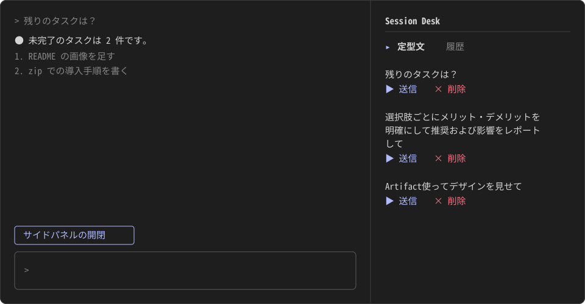
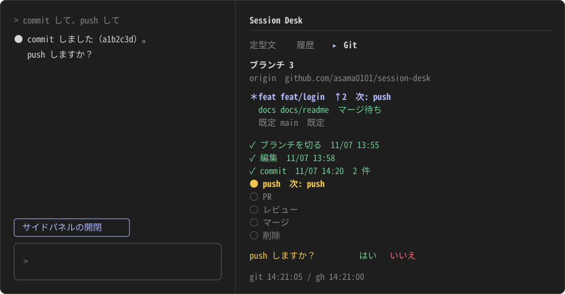
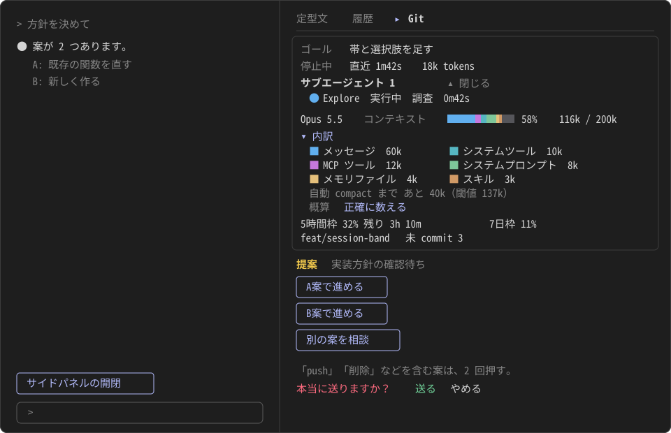

# session-desk

Claude Code の横にサイドパネル「Session Desk」を出す mod（Claude Code を拡張する追加機能）。定型文の送信、送ったプロンプトの履歴、Git ブランチの進み具合の確認、Claude の作業状況（ゴール・コンテキスト・上限）の確認ができる。Claude Code の利用者向け。







## 機能

パネルには 3 つのタブがある。初めに開くのは定型文。

| タブ | できること |
|---|---|
| 定型文 | 登録した文をボタン 1 つで送信する。好きな文を足す、並び替える、削除する |
| 履歴 | 自分が送ったプロンプトを新しい順に見る。全文の表示と、定型文への追加ができる |
| Git | ブランチの一覧と、選んだブランチの経過（どこまで済んで、次に何をするか）を、色と日時つきで見る |

パネルの一番上に、「セッション帯」が出る。その下に、タブの行、各タブの内容が並ぶ。Claude の作業の状況（ゴール、実行状態、サブエージェント、モデルとコンテキストの使用量、5 時間枠・7 日枠の使用率、ブランチ名）が、どのタブを開いていても見える。Claude が止まって人の判断を待つときは、帯の下に「提案」の選択肢が出て、押すとその文が Claude に送られる。

「Git」タブは、ブランチの進み具合を見るだけ。パネルは git や gh に書き込まず、Claude に依頼も送らない。

入力欄の上に「サイドパネルの開閉」ボタンも出る。アンケートの表示中は、このボタンは出ない。

## 前提条件

- Claude Code 2.1.319（作者が使っているバージョン。ほかのバージョンは未検証）
- Windows 11（作者が使っている OS。ほかの OS は未検証）
- Git 2.41 以上（「Git」タブが使う。それより古くても動くが、ブランチが多いと「判定できない」が増える）
- GitHub CLI の `gh`（なくても動く。入っていてログイン済みなら、「Git」タブに PR とレビューの状態が出る）
- ゴールと「提案」の選択肢は、Claude の返答ごとに、小さな Claude の呼び出しを 1 回、追加で使う（そのぶんの利用量がかかる）

## 導入方法

Claude Code の入力欄で、次のコマンドを実行する。マーケットプレイス（プラグインの配布元）の追加を聞かれたら `y` を押し、範囲（スコープ）を選ぶ。

```
/plugin install session-desk --marketplace asama0101/session-desk
```

シェルからは、次のコマンドを実行する。

```bash
claude plugin install session-desk --marketplace asama0101/session-desk
```

端末の幅が 144 列以上なら、導入後に開始したセッションでパネルが自動で開く。144 列未満のときは、「サイドパネルの開閉」ボタンを押して開く。

### zip をダウンロードして導入する

GitHub が使えない環境や、コードを確認してから入れたいときに使う。

**置き場所**: 導入したあとも消さない、決まったフォルダに置く。この手順では、`C:\Users\<ユーザー名>\claude-plugins`（PowerShell の `$HOME\claude-plugins`）にする。ダウンロードフォルダ、デスクトップ、一時フォルダには置かない。導入した mod は、展開したフォルダを直接読むので、あとで削除、移動、名前変更すると動かなくなる。

PowerShell で、次のコマンドを実行する。`$HOME\claude-plugins\session-desk-main` フォルダができる。

```powershell
New-Item -ItemType Directory -Force $HOME\claude-plugins
Set-Location $HOME\claude-plugins
Invoke-WebRequest https://github.com/asama0101/session-desk/archive/refs/heads/main.zip -OutFile session-desk.zip
Expand-Archive session-desk.zip -DestinationPath .
claude plugin install session-desk --marketplace ./session-desk-main
```

ブラウザから取る場合は、[main.zip](https://github.com/asama0101/session-desk/archive/refs/heads/main.zip) を保存し、`$HOME\claude-plugins` に展開する。そのあと、`Set-Location $HOME\claude-plugins` と、最後の 1 行だけを実行する。展開した `session-desk-main` フォルダは、そこに置いたままにする。

### 保存せずに試す

このリポジトリを手元に取得（`git clone`、または上の zip を展開）する。取得したフォルダの中で（zip なら `session-desk-main` フォルダの中で）、次のコマンドを実行する。そのセッションだけで有効になる。

```bash
claude --plugin-dir ./session-desk
```

### アンインストール

**警告**: アンインストールすると、パネルが出なくなる。戻すときは、上の導入方法のコマンドをもう一度実行する。

次の 2 つのコマンドを実行する。

```bash
claude plugin uninstall session-desk
claude plugin marketplace remove session-desk
```

zip で導入した場合は、そのあとで `$HOME\claude-plugins\session-desk-main` フォルダを消してよい。

## 使い方

### 基本の流れ

1. 導入して、Claude Code を新しく起動する。パネルに「定型文」タブが開き、初期の定型文 3 件が並ぶ。
2. 定型文の「▶ 送信」を押す。その文が、入力欄から送ったときと同じように送られる。
3. 入力欄にプロンプトを 1 件送る。パネルの「履歴」を押すと、送ったプロンプトが `1. <送ったプロンプト>` の形で出る。
4. 「＋ 定型文に追加」を押し、「定型文」を押す。追加した文が、定型文の末尾に出る。
5. Git のリポジトリのフォルダなら、「Git」を押す。ブランチの一覧と、いまのブランチの経過が出る。
6. パネルの一番上に、セッション帯が出ている。Claude が答え終わると、帯のゴールが更新される。

### パネルを開閉する

入力欄の上の「サイドパネルの開閉」ボタンを押す。端末の幅が狭くてパネルが描かれないときも、押すと開く。

### 定型文

- 一覧の上の入力欄に文を入力して Enter を押すと、その文が一覧の末尾に足される。空の文と、すでにある文は足されない。1 行の文だけを入力できる。
- 操作は、どの行も「▶ 送信」「× 削除」「▲ 上へ」「▼ 下へ」の順に並ぶ。「▲ 上へ」「▼ 下へ」を押すと、その文が 1 つ上（下）へ動く。先頭の文の「▲ 上へ」と、末尾の文の「▼ 下へ」は、押せない薄い字で出る。並び順は、次のセッションにも残る。
- 定型文が 6 件以上になると、先頭の 5 件だけが出て、下に「▾ もっと見る（あと N 件）」が出る。押すと残りが開き、「▴ 閉じる」で戻る。
- 「▶ 送信」を押すと、確認なしですぐにその文を送信する。
- 「× 削除」を押すと、確認なしですぐにその文を一覧から消す。同じセッションの中なら、履歴から「＋ 定型文に追加」で足し直せる。セッションをまたぐと履歴は消えているので、文を手で入力し直す。
- 定型文は、次のセッションにも残る。入力欄や「＋ 定型文に追加」で足した文は、全文が保存される。パスワードなどの秘密を書いたプロンプトは、追加しない。
- 初期値は次の 3 つ。
  - 残りのタスクは？
  - 選択肢ごとにメリット・デメリットを明確にして推奨および影響をレポートして
  - Artifact使ってデザインを見せて

### 履歴

- 番号は送信順で、新しいプロンプトが上に並ぶ。6 件以上になると、新しい 5 件だけが出て、下に「▾ もっと見る（あと N 件）」が出る。押すと古いものまで開き、「▴ 閉じる」で戻る。
- プロンプトは 60 字までに短くして並ぶ。「▾ 全文」を押すと、その 1 件が全文になる。「▴ 短く」で戻る。全文を開けるのは同時に 1 件だけ。
- 「＋ 定型文に追加」を押すと、そのプロンプトを定型文に足す。同じ文は重複して追加されない。
- 記録するのは、次の 3 つだけ。空のプロンプトとサブエージェント宛ては記録しない。
  - 入力欄から送ったプロンプト
  - Remote Control（スマートフォンや Web の接続先）から送ったプロンプト
  - パネルの「▶ 送信」で送ったプロンプト
- 履歴はセッションごとに持つ。次のセッションには残らない。

### セッション帯

パネルの一番上に出る。見出しは `Session` とモデル名（色はモデルの系統で変わる。Opus は紫、Sonnet は水色、Haiku は青、Fable は明るい水色）。その下は、状態、コンテキスト、利用枠とブランチの 3 段に分かれ、段と段のあいだは細い線で区切られる（見出しと最初の段のあいだに線はない）。値のない段は出ない。外枠はない。どのタブを開いていても見える。読み取れない項目は出ない。

| 項目 | 見方 |
|---|---|
| ゴール | Claude が、返答のたびに 1 行でまとめる。目的が大きく変わったときだけ書き換わる |
| 実行状態 | `実行中 Bash 0m42s`（動いているツールと経過時間）、または `停止中  直近 1m42s  18k tokens`（直近の返答の所要時間とトークン数）。エラーなら `エラーで停止`、拒否なら `拒否で停止`、止めたなら `中断` |
| サブエージェント | 動いている数と一覧。動き出すと一覧が自動で開く。「▴ 閉じる」「▾ 開く」で切り替える。各行は、記号（`●` 実行中、`◌` 待機、`○` 完了）・種類・状態・内容・経過時間で、完了した行には経過時間が出ない |
| コンテキスト | 左に見出し、右端に使用率と使用トークン数・窓の大きさ（例: `116k / 200k`）。その下に、枠の幅いっぱいの色分けしたバー。使用率の数字は、通常は緑、80% 以上で黄、95% 以上で赤 |
| 5時間枠・7日枠 | 使用率のバー（緑、80% 以上で黄、95% 以上で赤）と、使用率、残り時間。上限のないアカウントでは出ない |
| ブランチ | ブランチ名と、未 commit の変更の数。分離状態は `(detached)`。Git のリポジトリの外では出ない |

- ブランチ名は水色。
- コンテキストのバーから 1 行あけて、内訳の凡例が常に出る。メッセージ・MCP・ツール・システム・メモリ・スキル・空きが、短い名前と色・トークン数で、1 行に 1 項目ずつ縦に並ぶ。色だけでなく、名前でも見分けられる。
- MCP ツール・メモリファイル・スキルの行には「▸ 1 件ずつ」が出る。押すと、1 件ずつの内訳が開く。
- 凡例の下に `自動 compact まで あと …（閾値 …）` と `概算` が出る。「正確に数える」を押すと、そのときだけ正確に数え直す（Claude の API を呼ぶ）。
- 数え直した内訳は、`概算` の代わりに `正確` と出て、次に Claude が動き出すまで残る。数えている間は、もう一度押しても何も起きない。

### 停止後の選択肢

Claude の返答が人の判断を求めているとき（質問、案の選択、確認待ち）、タブの内容の下に、二重線で区切って「提案」が出る。見出し「提案」と短い理由、番号つきの最大 4 行。

```
提案  実装方針の確認待ち
1  A案で進める (推奨)
2  B案で進める
3  別の案を相談
```

- ボタンを押すと、そのボタンの文が、そのまま Claude に送られる。送った文は「履歴」にも載る。
- Claude が勧める案があるときは、その行の文が太字になり、末尾に緑で `(推奨)` と出る。勧める案がないときは、印は出ない。押す前に確認は挟まない。どの案も、押すとすぐ送る。
- Claude が動いている間と、エラー・拒否・中断で止まったときは、選択肢は出ない。
- 選択肢が出ないときは、「困ったとき」の「選択肢（提案）が出ない」を見る。

### Git タブ

「Git」タブは、Claude Code を開いているフォルダのリポジトリ 1 つを見る。見出しの下にリモート、その下にブランチの一覧が並ぶ。いまチェックアウトしているブランチには `＊` が付く。

ブランチが 6 つ以上あるときは、先頭の 5 つだけが出て、下に「▾ もっと見る（あと N 件）」が出る。いまのブランチと、選んだブランチは、5 つの外にあっても出る。

一覧の行を押すと、そのブランチの「経過」が縦に並ぶ。経過は、「ブランチを切る → 編集 → commit → レビュー（PR 前） → push → PR → レビュー（PR 上） → マージ → 削除」の 9 つの段階の一覧。

```
✓ ブランチを切る  11/07 13:55
✓ 編集  11/07 13:58
✓ commit  11/07 14:20  2 件
● レビュー（PR 前）  次: レビュー
○ push
○ PR
○ レビュー（PR 上）
○ マージ
○ 削除
```

各段階の先頭の記号と色で、状態が分かる。日時が取れない段階は、日時の代わりに `—` と出る。

| 記号 | 意味 | 色 |
|---|---|---|
| `✓` | 済（日時つき） | 緑 |
| `●` | 今（次に取りかかる段階） | 黄色・太字 |
| `○` | これから | 灰色 |
| `?` | 取れなかった | 赤 |
| `－` | 省略または対象外 | 灰色 |

一覧の行の右端にも、そのブランチの「今」が出る。行の色は、「今」で決まる。

| 一覧の右端 | 意味 | 色 |
|---|---|---|
| `次: 編集` | 切ったばかりで、commit も変更もまだない | 灰色 |
| `編集中` | 未 commit の変更がある | 黄色 |
| `次: レビュー` | commit 済みで、push の前のレビューがまだ | 青 |
| `次: push` | レビュー（PR 前）が済み、push がまだ | 青 |
| `次: PR を作る` | push 済みで、PR がまだ | 青 |
| `次: PR を作り直す` | PR が閉じられている | 青 |
| `次: レビューを待つ` | レビューを待っている | 黄色 |
| `次: 指摘を直す` | 変更を求められている | 黄色 |
| `次: 草稿を解除する` | PR が草稿（draft）のまま | 黄色 |
| `マージ待ち` | マージを待っている | 緑 |
| `次: ブランチを削除` | PR がマージ済み | 紫 |
| `commit 済み（リモートなし）` | commit まで済み、リモートがない | 緑 |
| `今: 判定できない`、`今: PR 以降は不明` | 情報が取れなかった | 赤 |
| `既定` | main など既定のブランチ（経過は出ない） | 灰色 |

- 種類は、ブランチ名の接頭辞（`feat/` `fix/` `docs/` `chore/`）で決まる。ほかの名前は「その他」。
- 「レビュー（PR 前）」は、git からは済んだかどうかが分からない。push 済みなら済んだとみなし、commit 済みで push がまだなら「今」にする。リモートがなければ、`－` で飛ばされる。
- レビューの設定がないリポジトリ（1 人で開発するときなど）では、「レビュー（PR 上）」は `－` で飛ばされる。PR を作ったあとの「今」は `マージ待ち` になる。
- 一覧の行に `↑2 ↓1` が付くのは、origin に同名のブランチがあって、差があるとき。`↑` は origin にまだない commit の数（push が必要）、`↓` は origin だけにある commit の数。
- 一番下の行は、git と gh を最後に読んだ時刻（例: `git 14:21:05 / gh 14:21:00`）。
- 一覧の下に黄色い文が出ることがある。

| 黄色い文 | 意味 |
|---|---|
| `HEAD は分離状態` | どのブランチもチェックアウトしていない |
| `既定ブランチ上に未 commit の変更があります` | 作業ブランチを切らずに、既定ブランチで編集している |
| `既定ブランチに未 push の commit があります` | 既定ブランチの commit が、origin にまだない |
| `ブランチ一覧が長すぎます` | ブランチが多すぎて、一覧を出せない |

- 出さないもの: リリース（タグ）、CI の結果、マージ競合、別の worktree で checkout 中のブランチの未 commit の変更。

### Git タブのリモートの表示

- 見出しの下に、リモートの名前と URL が 1 つ 1 行で並ぶ。例: `origin  github.com/asama0101/session-desk`
- リモートの名前は強調色、URL は通常の色で出る。
- URL は読みやすく整える。認証情報（`user:token@`）は出さない。URL が空のリモートは、`（URL なし）` と出る。
- リモートが複数あっても全部出す。push・PR・差の判定に使うのは、名前が `origin` のリモートだけ。
- リモートがないときは `リモートなし`、`origin` だけがないときは、ほかのリモートの下に `origin なし` と出る。どちらも、push 以降の段階は `－`（対象外）になり、一番下の行の gh は `対象外` になる。
- `git remote -v` が失敗したときは `リモート: 不明` と出る。そのときは、origin があるものとして表示する。

### Git タブの更新のタイミング

- 更新するのは、パネルが開いている間だけ。
- 「Git」タブを押したとき、Claude が Bash・Edit・Write を使った直後、10 秒おきに、git の状態を読み直す。
- 「Git」タブ以外を表示している間は、セッション帯のために、今のブランチ名と未 commit の数だけを読む（全ブランチの一覧と gh は読まない）。
- PR とレビューの状態（gh）は、タブを押したとき、`gh` や `git push` を含むコマンドの直後、60 秒おきに読み直す。失敗が続くと、間隔を最大 10 分まで延ばす。延びている間は、タブを押しても gh は読み直さない（git は読み直す）。
- Claude Code を開いているフォルダが変わったときは、前の表示を消して、gh の間隔を最初に戻し、読み直す。
- 読み取りだけで、`git fetch` はしない。origin の情報は、手元に取り込み済みの分になる。

## 困ったとき

### パネルが出ない

端末の幅が足りないと、パネルは描かれずに待つ。端末の幅を 144 列以上にするか、入力欄の上の「サイドパネルの開閉」ボタンを押す。

アンケートの表示中は、ボタンが出ない。アンケートに答えるか閉じると、ボタンが出る。

### 「Git」タブの一番下に「gh 不明」と出る

`gh` が入っていない、ログインしていない、または通信に失敗した。PR 以降の段階が `?` になるが、commit や push までの段階は正しく出る。`gh auth status` でログインを確かめる。

### 「Git のリポジトリではありません」と出る

Claude Code を開いているフォルダが、Git のリポジトリではない。リポジトリのフォルダで Claude Code を開き直す。

### 「リポジトリの所有者が違います」と出る

git が、このフォルダの持ち主と、いまのユーザーが違うと判断している（Windows で起きやすい）。信頼できるフォルダなら、そのフォルダで次のコマンドを実行する。git の設定が変わるので、信頼できるフォルダだけに行う。

```bash
git config --global --add safe.directory <フォルダのパス>
```

### 「取得が時間切れか、git を実行できません」と出る

git が 15 秒以内に終わらなかったか、git を起動できなかった。`git --version` で、git が使えるか確かめる。大きなリポジトリでは、時間がかかることがある。

### 「git の実行に失敗しました」と出る

git が、ブランチの一覧を読むコマンドでエラーを返した。リポジトリが壊れている可能性がある。そのフォルダで `git status` を実行して、エラーの内容を確かめる。

### 「ブランチがありません」と出る

一覧に出せるブランチがない。一覧の下に「ブランチ一覧が長すぎます」と出ているときは、ブランチが多すぎて一覧を出せなかった。使っていないブランチを減らす。

### 「commit がまだありません」と出る

このリポジトリには、commit が 1 件もない。最初の commit を作る。

### 「リモートなし」「origin なし」と出るのに、リモートがある

「Git」タブが push・PR の判定に使うのは、名前が `origin` のリモートだけ。`git remote -v` で名前を確かめる。別の名前なら、`git remote rename <いまの名前> origin` で変えられる（ほかの人の手順や設定が変わらないか、確かめてから行う）。

### 選択肢（提案）が出ない

選択肢は、Claude の返答が人の判断を求めているときだけ出る。次のときは出ない。

- Claude が動いている間（止まってから出る）。
- エラー、拒否、中断で止まったとき。
- 返答が判断を求めていないとき。
- 選択肢を作る呼び出しが失敗したとき（ゴールも前回のまま残る）。

### 「正確な数え直しに失敗しました」と出る

「正確に数える」で、トークン数を数える Claude の API の呼び出しに失敗した。内訳は `概算` のまま出る。少し待ってから、もう一度押す。

### 「Git タブを更新できませんでした」と出る

更新の途中で、予期しない失敗が起きた。「Git」タブを押し直す。直らなければ、Claude Code を起動し直す。

## ライセンス

MIT License。商用利用、改変、再配布ができる。コピーには、著作権表示と [LICENSE](LICENSE) の全文を付ける。
